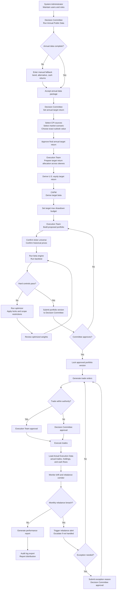
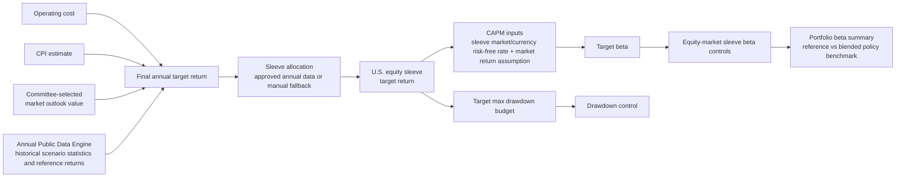
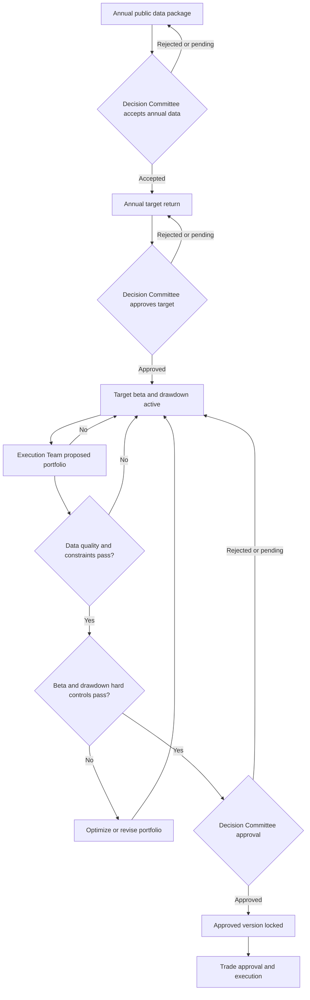

# System Workflow Diagram

Version: 0.1
Date: 2026-06-21
Updated: 2026-07-12

This document works together with:

- `docs/Investment_Management_Tool_SOP.md`
- `docs/IT_System_Check_and_Finetune_Guide.md`
- `docs/current_logic_overview.md`
- `docs/simple_workflow_review.html`

## 1. End-to-End Workflow



## 2. Target Return to Target Beta Chain



## 3. Approval Gates



## 4. Hard Controls vs Reference Indicators

| Item | Role in approval | Notes |
| --- | --- | --- |
| U.S. equity target beta | Hard control | Derived from CAPM using U.S. equity sleeve target return |
| Other equity-market sleeve beta | Hard control | Each equity market should use its own appropriate market benchmark |
| Portfolio beta summary | Reference indicator | Monitors total risk versus a blended policy benchmark; does not replace sleeve beta controls |
| Target max drawdown | Hard control | Proposed equity summary uses the base drawdown budget; each sleeve uses its own risk-adjusted budget |
| Allocation constraints | Hard control | Region, asset class, style, ticker count, and single security limits |
| Data quality | Hard control | Required before approval and implementation |
| Backtested return | Hard control | Each sleeve and the proposed equity summary must be within the approved tolerance versus target |
| Realized return | Reporting indicator | Used after implementation for monitoring and reporting |

## 5. Step-By-Step Chinese Explanation

| Step | 中文说明 |
| --- | --- |
| 1. Users and roles | 系统管理员维护用户。审批只保留两个业务角色：决策委员会审批人和执行小组审批人。 |
| 2. Annual public data | 决策委员会先运行或上传年度公开数据包，系统根据历史价格、ticker universe 和市场统计数据生成牛市、平衡市、熊市下的大类资产和股票 sleeve 建议。缺失值可手工补入。 |
| 3. Annual target return | 决策委员会再判断未来 12 个月是牛市、熊市还是平衡市。系统给出参考区间，决策委员会在区间内确定具体目标收益值并审批。 |
| 4. Allocation guidance | 执行小组读取已接受的年度公开数据包，沿用同一个牛熊市判断，准备大类资产配置建议和股票 Return/Beta Sleeve 配置建议。 |
| 5. Sleeve return split | 执行小组把已批准的整体目标收益率拆到各个 sleeve。股票 sleeve 得到各自目标收益率，债券、另类和现金使用参考收益率。 |
| 6. CAPM beta targets | 执行小组准备 CAPM 假设；股票 sleeve 用各自目标收益率和各自市场无风险利率通过 CAPM 倒推 target beta。股票市场范围为 U.S. equity、Japan equity、Hong Kong equity 和 China A equity。 |
| 7. Proposed portfolio | 执行小组按资产、Return/Beta Sleeve、Geographic Region、风格、主题和单票上限提出具体标的和权重。 |
| 8. Backtest and optimize | 使用第 3 步加载的市场价格和 benchmark 数据检查每个 sleeve 的收益率、beta 和最大回撤是否达标；不达标则给出优化权重。 |
| 9. Approvals | 年度目标和组合实施由决策委员会审批人批准；具体交易由执行小组授权人确认；例外事项上报决策委员会。 |
| 10. Load actual execution data | 生成买卖记录，经过执行小组授权后执行；交易完成后再加载真实成交、真实持仓和现金流数据。 |
| 11. Rebalance monitoring | 每日加载真实持仓用于更新数据；正式 sleeve/style corridor 检查按月进行。只有月度检查发现越界时，系统才给出标准买卖方案和完成期限。 |
| 12. Reports and review | 按日、周、季、年或自定义期间出报告，对比收益、target beta、最大回撤、再平衡提醒，并给出年度归因结论：决策委员会主导、执行小组主导或混合贡献。 |

## 6. Terminology Rule

Return/Beta Sleeve and Geographic Region are separate fields.

Example: a Japanese equity holding should be classified as:

- Return/Beta Sleeve: Japan equity
- Geographic Region: Japan

This avoids mixing beta calculation groups with geographic reporting groups.

## 7. Current Prototype Files Related to This Diagram

```text
docs/Investment_Management_Tool_SOP.md
docs/IT_System_Check_and_Finetune_Guide.md
docs/current_logic_overview.md
docs/simple_workflow_review.html
simulation/output/full_workflow_result.md
simulation/run_full_workflow_simulation.mjs
```
